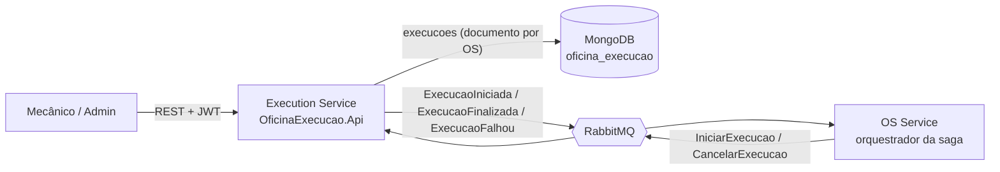

# Oficina Mecânica — Execution Service

Microsserviço de **fila de execução e produção** das ordens de serviço (Tech Challenge FIAP — Fase 4).
Recebe da saga as OSs com pagamento aprovado, coloca na fila dos mecânicos e acompanha o diagnóstico,
o reparo e a execução de cada serviço até a finalização (ou falha).

| | |
|---|---|
| Stack | .NET 8, ASP.NET Core, MongoDB (`MongoDB.Driver`), MassTransit 8.5 + RabbitMQ |
| Banco | MongoDB — database `oficina_execucao`, coleção `execucoes` |
| Papel na Saga | Participante (o orquestrador é o OS Service, repo `konrath9/OficinaMecanica`) |
| Swagger | `/execucao/swagger` (local: http://localhost:5002/execucao/swagger) |
| Contratos | `OficinaExecucao.Api/Contracts/Mensagens.cs` — cópia de `docs/fase4/contratos-mensageria.md` do repo do OS Service |

## Arquitetura



Projetos:

- `OficinaExecucao.Domain` — agregado `Execucao` com as transições de status protegidas
  (`NaFila → EmDiagnostico → EmReparo → Finalizada`, `Falhou`, `Cancelada`) e histórico de cada transição.
- `OficinaExecucao.Api` — controllers, consumers MassTransit, repositório MongoDB, métricas e observabilidade.
- `OficinaExecucao.Tests` — xUnit: domínio, consumers (MassTransit test harness) e API (WebApplicationFactory).

### Por que NoSQL (MongoDB) aqui

- A execução de uma OS é um **agregado auto-contido**: status, lista de serviços (com início/fim de cada um) e
  histórico de transições são lidos e gravados sempre juntos. Em MongoDB isso é **um documento**, gravado
  atomicamente com um único `ReplaceOne` (upsert por `OrdemServicoId`), sem tabelas filhas nem joins.
- O esquema **evolui por tipo de reparo** (checklists, medições, fotos e observações específicas podem ser
  acrescentados a serviços ou ao histórico sem migration), e documentos antigos continuam válidos
  (`IgnoreExtraElements` ligado).
- O serviço **não precisa de joins** com dados de outros contextos: tudo o que a fila precisa (número da OS e serviços)
  chega no comando `IniciarExecucao`. Clientes, veículos e valores ficam nos serviços donos desses dados.
- A consulta da fila é simples (status em andamento + data de criação) e é servida pelo índice `{ Status, CriadaEm }`.

## Papel na Saga

| Direção | Mensagem | Comportamento |
|---|---|---|
| consome | `IniciarExecucao` | Cria o documento com status `NaFila` (upsert idempotente: reentrega não recria) e publica `ExecucaoIniciada`. |
| consome | `CancelarExecucao` (compensação) | Status `Cancelada`, se ainda não finalizada. Idempotente (já cancelada, finalizada ou inexistente → ignora). |
| publica | `ExecucaoIniciada` | OS entrou na fila de execução. |
| publica | `ExecucaoFinalizada` | Último serviço da OS finalizado (ou OS sem serviços ao iniciar o reparo). |
| publica | `ExecucaoFalhou` | Mecânico registrou falha via `POST .../falha` — **dispara a compensação**: a saga envia `EstornarPagamento` ao Billing Service e a OS termina `Cancelada` após `PagamentoEstornado`. |

Mensageria conforme o contrato: todas as mensagens são publicadas, `SetKebabCaseEndpointNameFormatter()` +
`ConfigureEndpoints`, retry `Interval(3, 2s)` e, esgotado, fila `_error`.

## Endpoints

Todos exigem JWT emitido pelo OS Service. Leitura: `Administrador`, `Mecanico`, `Recepcionista`.
Mutações: `Administrador`, `Mecanico`. Transição inválida → **400**; OS/serviço inexistente → **404**.

| Método | Rota | Descrição |
|---|---|---|
| GET | `/api/execucoes` | Fila de execução (status não finais), ordenada: `EmReparo` > `EmDiagnostico` > `NaFila`, mais antigas primeiro |
| GET | `/api/execucoes/{ordemServicoId}` | Detalhes, progresso (`servicosConcluidos`/`totalServicos`) e histórico |
| POST | `/api/execucoes/{ordemServicoId}/iniciar-diagnostico` | `NaFila → EmDiagnostico` |
| POST | `/api/execucoes/{ordemServicoId}/iniciar-reparo` | `EmDiagnostico → EmReparo` |
| PUT | `/api/execucoes/{ordemServicoId}/servicos/{servicoId}/iniciar` | Inicia um serviço (exige `EmReparo`) |
| PUT | `/api/execucoes/{ordemServicoId}/servicos/{servicoId}/finalizar` | Finaliza um serviço; `execucaoFinalizada: true` quando era o último (publica `ExecucaoFinalizada`) |
| POST | `/api/execucoes/{ordemServicoId}/falha` | Body `{ "motivo": "..." }` → `Falhou` e publica `ExecucaoFalhou` |
| GET | `/health` | Health check (ping no MongoDB) |
| GET | `/execucao/swagger` | Swagger UI |

## Observabilidade

- Logs JSON (Serilog `CompactJsonFormatter`) com `CorrelationId` (header `X-Correlation-Id`).
- OpenTelemetry → New Relic via OTLP **somente se** `NewRelic__LicenseKey` estiver configurado
  (service name `oficina-execution-service`): traces (ASP.NET Core + `MassTransit`, trace distribuído entre serviços), métricas e logs.
- Métricas de negócio (meter `OficinaExecucao`): histograma `execucao.duracao_segundos` (entrada na fila → finalizada)
  e contador `execucao.falhas`.

## Rodando localmente

```bash
docker compose up --build          # API em http://localhost:5002, Mongo 27017, RabbitMQ 5672 (UI 15672, oficina/oficina123)
```

Ou só a infraestrutura em containers e a API pelo SDK:

```bash
docker compose up -d mongodb rabbitmq
dotnet run --project OficinaExecucao.Api   # http://localhost:5002/execucao/swagger
```

Configuração (env vars):

| Variável | Padrão |
|---|---|
| `Mongo__ConnectionString` | `mongodb://localhost:27017` |
| `Mongo__Database` | `oficina_execucao` |
| `RabbitMq__Host` / `RabbitMq__Username` / `RabbitMq__Password` | `localhost` / `oficina` / `oficina123` |
| `Jwt__SecretKey` / `Jwt__Issuer` / `Jwt__Audience` | iguais ao OS Service (`OficinaMecanicaAPI` / `OficinaMecanicaClients`) |
| `NewRelic__LicenseKey` | vazio (exportação desligada) |

Para testar o fluxo sem o OS Service, publique um `IniciarExecucao` pela UI do RabbitMQ ou gere um token no OS Service
(`POST /api/autenticacao/login`) e use os endpoints acima.

## Testes e cobertura

```bash
dotnet test /p:CollectCoverage=true /p:Threshold=80 /p:ThresholdType=line /p:CoverletOutputFormat=opencover
```

(no Git Bash do Windows use `-p:` no lugar de `/p:`). O build falha se a cobertura de linhas ficar abaixo de 80%.

Resultado medido localmente em Debug (30 testes, todos passando; em Release, como no CI, o total de linhas fica em 94%):

| Módulo | Linhas | Branches |
|---|---|---|
| OficinaExecucao.Api | 92% | 97,36% |
| OficinaExecucao.Domain | 99,05% | 100% |
| **Total** | **94,92%** | **98,27%** |

Cobertura: transições do domínio (válidas e inválidas), consumers via `MassTransit.Testing` (caminho feliz,
idempotência, cancelamento), API via `WebApplicationFactory` com repositório em memória e test harness no lugar do
RabbitMQ (401/403 por perfil, 400/404, ordenação da fila, publicação de `ExecucaoFinalizada`/`ExecucaoFalhou`,
Swagger, health e correlation id) e round-trip BSON do agregado (mapeamento do Mongo sem servidor).

Fora da medição: `Program.cs` e o adaptador fino do driver (`MongoExecucaoRepository` e `MongoHealthCheck`,
marcados com `[ExcludeFromCodeCoverage]`), que só fazem sentido contra um servidor MongoDB real — esse caminho é
validado pelo deploy + smoke test no cluster `kind` do CI.

SonarCloud: _[badge / print do quality gate — adicionar após a primeira análise]_
<!-- [](https://sonarcloud.io/summary/new_code?id=konrath9_oficina-execution-service) -->

## CI/CD

`.github/workflows/ci-cd.yml`:

1. **build-test** (PR e push na `main`): restore → build → testes com gate de cobertura ≥ 80% → SonarCloud
   (`konrath9_oficina-execution-service`, relatório opencover; ignorado com aviso se `SONAR_TOKEN` não existir).
2. **deploy-homologacao** (push na `main`): imagem `ghcr.io/konrath9/oficina-execution-service:{sha}` e `:latest` →
   cluster `kind` efêmero → aplica o RabbitMQ do repo do orquestrador
   (`raw.githubusercontent.com/konrath9/OficinaMecanica/master/k8s/rabbitmq.yaml`), `k8s/mongodb.yaml` e a aplicação →
   rollout → smoke test em `/execucao/swagger/v1/swagger.json`.
3. **deploy-producao** (após homologação): gera o Secret de produção a partir dos GitHub secrets, copia os manifestos
   (exceto `secret.yaml` de demo) via SSH para o node k3s, aplica, aguarda rollout e faz smoke test via Traefik
   (`http://$K3S_HOST/execucao/swagger/v1/swagger.json`).

Kubernetes (`k8s/`, namespace `oficina-mecanica`): ConfigMap, Secret (demo), Deployment (requests 100m/192Mi,
limits 500m/384Mi), Service ClusterIP 8080, HPA 1–2 réplicas, Ingress Traefik (`/api/execucoes`, `/execucao`) e
`mongodb.yaml` (StatefulSet `mongo:7`, PVC 1Gi, `--wiredTigerCacheSizeGB 0.25`, limit 384Mi, Service `mongodb`) —
o MongoDB pertence a este serviço e também roda em produção.

### Secrets necessários no GitHub

| Secret | Uso |
|---|---|
| `SONAR_TOKEN` | Análise no SonarCloud (opcional: sem ele a etapa é ignorada) |
| `K3S_HOST` | IP/DNS público do node k3s de produção |
| `K3S_SSH_PRIVATE_KEY` | Chave SSH (usuário `ubuntu`) do node k3s |
| `PROD_JWT_SECRET_KEY` | Chave JWT — **a mesma** do OS Service |
| `RABBITMQ_PASSWORD` | Senha do usuário `oficina` do RabbitMQ de produção |
| `NEW_RELIC_LICENSE_KEY` | License key do New Relic (vazio = sem exportação) |

O push da imagem no GHCR usa o `GITHUB_TOKEN` do próprio workflow (permissão `packages: write`).
